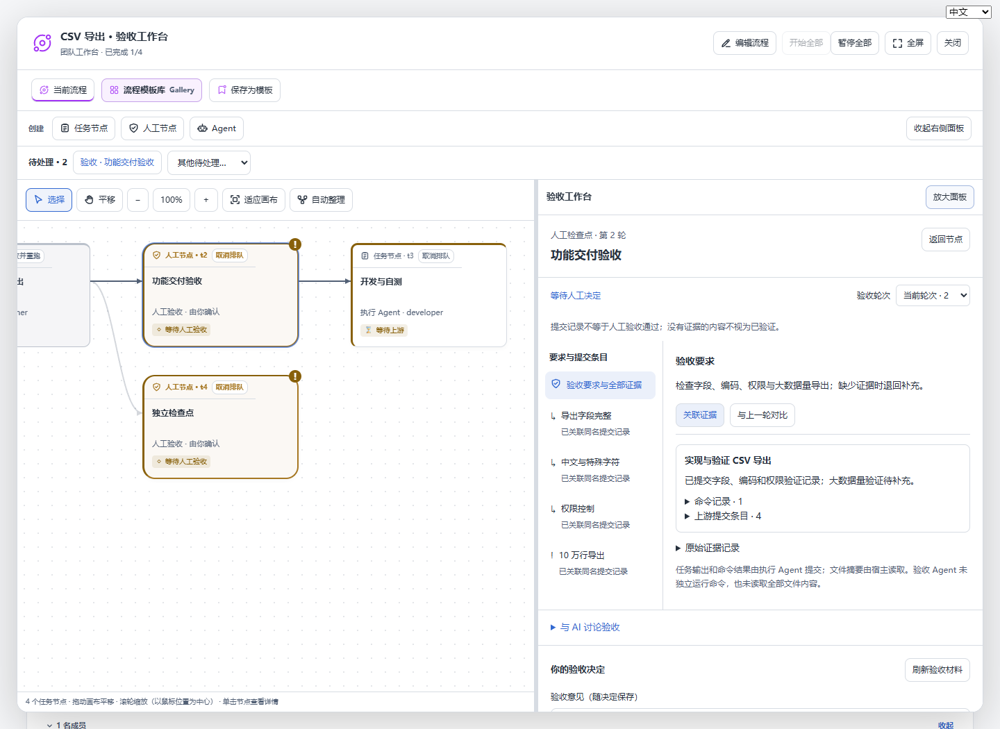
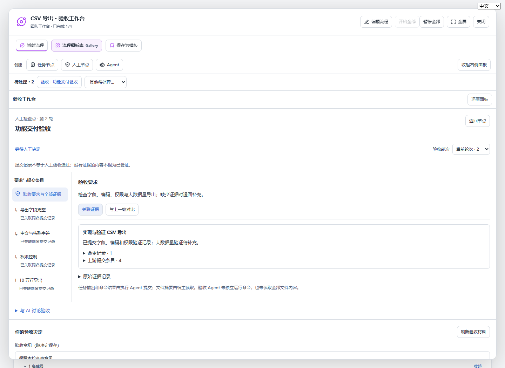
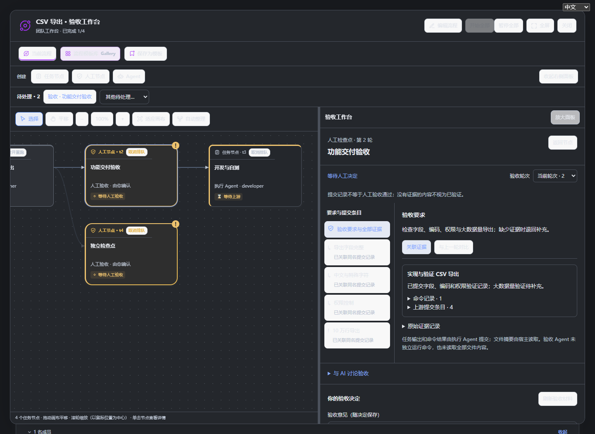

# 验收工作台 · 开发版验证

日期：2026-11-06。开发版 `0.2.6-dev.11`，工作分支 `dev`。

## 接入与兼容

- 入口：人工检查点详情的「开始验收／查看验收工作台」、顶部待处理、主对话验收提醒。全部复用现有 Workflow inspector，不创建第二套审批状态。
- 保留原有 review 路由、证据指纹校验、checkpointReady、重跑暂停、提案确认和独立讨论；查看材料不自动调用模型。继续讨论、重新开始讨论仍使用现有原生会话机制。
- 审批历史新增可选 `materials` 字符串，内容必须与当次证据指纹匹配。旧记录不需要迁移；缺少快照时只显示原审批信息。新快照随历史保留至返工、归档与恢复。
- 结构化验收标准仅与同名提交条目精确关联；其他上游报告标明来源。自由文本要求完整展示，不自动拆分或推断覆盖。文件摘要变化不等于源码 diff。
- 意见在工作台组件生命周期内按团队、检查点、轮次隔离；不是跨浏览器或跨重启的持久草稿。

## 验证结果

- 前后端 TypeScript 编译、客户端打包、Git 构建产物一致性通过。
- 按 `package.json` 的 `verify` 展开运行全部 36 个 Node 检查步骤，全部通过，包含新增证据解析/比较/中英文只读展示回归，以及实际 HTTP 决策后的快照持久化、返工保留、过期指纹拒绝。最后补回讨论重启入口及证据来源标签后，重跑相关展示和本地化测试（10 项）与浏览器检查通过。
- 包管理器的脚本入口在当前 Windows 沙箱触发依赖目录符号链接权限错误，因此构建和完整检查按现有脚本等价展开执行，没有改动依赖或跳过检查。临时目录归档操作也需要在沙箱外运行。
- 已打包产物在隔离 Harness **0.2.1-rc.5** 中通过 `web-approval` 和 `workflow-native-cold`：真实宿主加载、批准启动、人工检查点、返工阻塞、重跑路径和原生讨论冷恢复。复用已有精确 rc5 依赖目录，插件来自本次 tarball，未修改用户 profile。之后收尾改动仅在前端的讨论重启入口与证据来源展示，后端未变。
- 本地实际 React 界面使用 Edge 无头浏览器检查：提醒与节点详情入口、关联证据、历史轮次只读、上一轮比较、意见隔离、查看不触发模型、面板展开还原、中英文、600px 窄屏无溢出、深色主题、空退回意见阻止提交、取消通过确认不写入审批、实际退回与确认通过。浏览器无未捕获页面异常。

界面截图使用真实组件与模拟数据；浏览器预览不是宿主安装证明。宿主运行时验证使用本地确定性模型，没有调用真实模型服务。本次未验证原生 Desktop 操作、其他操作系统或用户已有数据的现场升级。

## 复现界面检查

先构建，然后在 PowerShell 中启动：

```powershell
$env:TEAMFLOW_PREVIEW_PORT='8376'
$env:TEAMFLOW_PREVIEW_REVIEW='1'
node scripts/workflow-preview.mjs
```

另一个终端运行 `node scripts/review-workbench-browser.mjs`，需要可用的 Playwright 和 Edge。可通过 `TEAMFLOW_PLAYWRIGHT_MODULE` 指定 Playwright 模块路径（Windows 使用 `file:///` URL），通过 `TEAMFLOW_BROWSER_CHANNEL` 选择浏览器。每次完整测试前重启预览服务，恢复模拟检查点的初始状态。截图默认写入 `output/review-workbench`。

## 实际界面

画布旁的验收工作台：



展开后在同一 Workflow 内检查证据：



深色主题：


